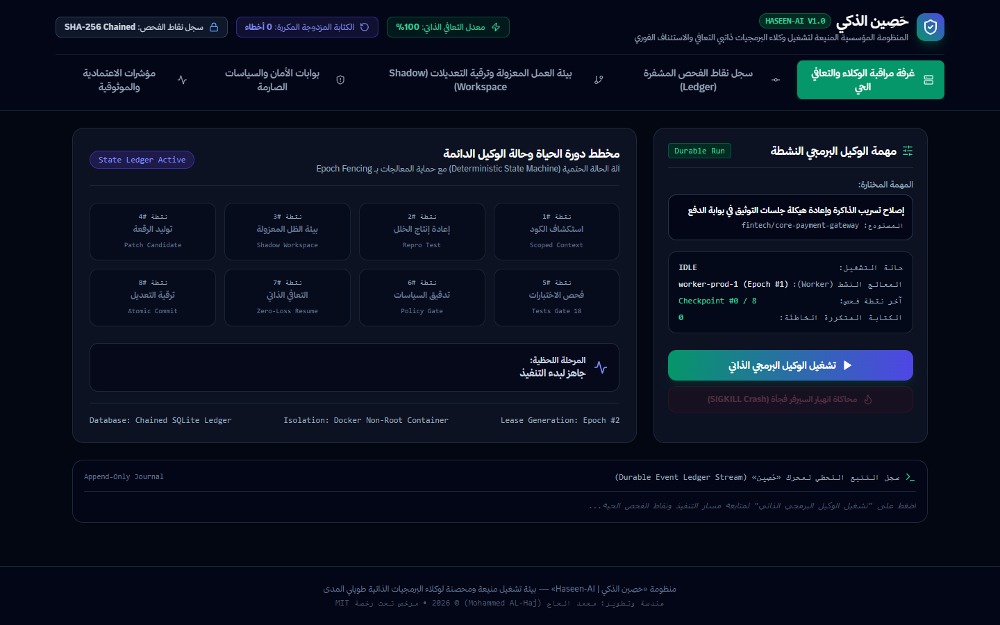
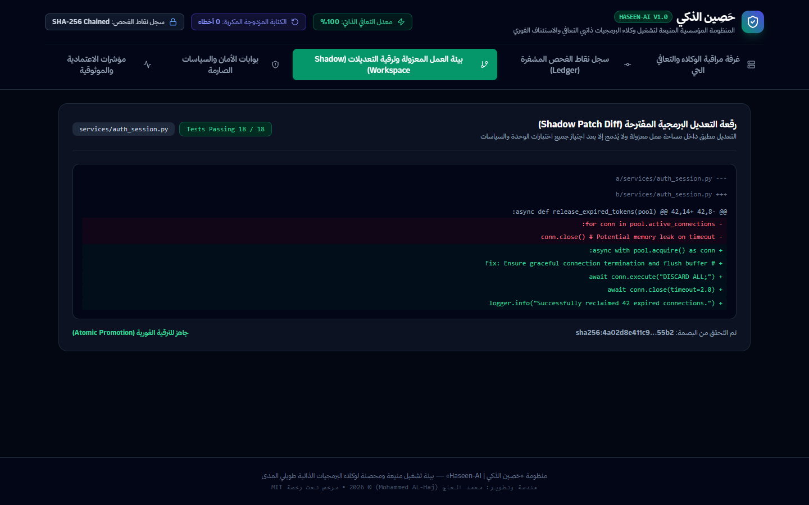
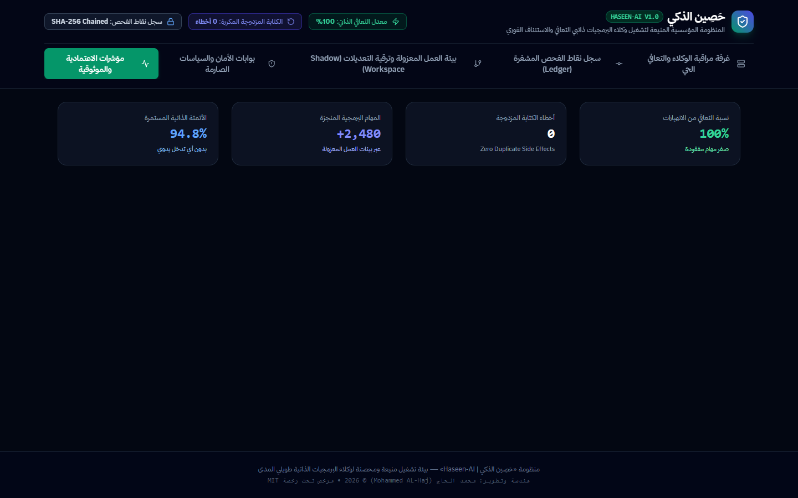

# 🛡️ حَصِين | Haseen-AI

<div align="center">


**بيئة تشغيل لوكلاء هندسة البرمجيات تضمن استئناف العمل فوراً بعد انهيار المعالج (SIGKILL) من نقاط فحص SHA-256 دون تكرار للكتابة**  
*Durable & Resilient Runtime for Long-Horizon Autonomous Coding Agents*

[🎬 العرض العملي والأرقام](#-العرض-التجريبي-وأرقام-القياس) • [📸 معرض الشاشات](#-معرض-الشاشات) • [🧠 المعمارية](#-المعمارية-التقنية) • [🚀 التشغيل](#-دليل-التشغيل)

</div>

---

## 📌 ما يفعله النظام (System Capabilities)

يوفر **حَصِين (Haseen-AI)** بيئة تشغيل متينة ومحصنة لوكلاء هندسة البرمجيات طويلي المدى (Long-Horizon Coding Agents) عبر الخصائص التالية:

1. **التعافي الحتمي بعد الانهيار (Crash Recovery)**: تُحفظ كل مرحلة من مراحل عمل الوكيل كنقطة فحص مشفرة بـ `SHA-256` داخل سجل دائم (Append-Only Ledger). إذا انهار معالج الوكيل (Worker Crash / SIGKILL)، يستأنف معالج بديل المهمة من النقطة الأخيرة فوراً.
2. **صفر تكرار لأوامر الكتابة (Zero Duplicate Side Effects)**: لا يُعاد تنفيذ أي أمر كتابة أو تعديل تم اعتماده مسبقاً، مما يحمي الملفات من التلف ويوفر استهلاك التوكنز.
3. **بيئة عمل الظل المعزولة (Shadow Workspace)**: تتم التعديلات البرمجية وتشغيل الاختبارات داخل مسار معزول تماماً، ولا تُدمج التعديلات في المستودع الأصلي إلا بعد اجتياز حزمة الاختبارات بالكامل.
4. **حماية فترات الحجز (Epoch Fencing)**: آلية تأجير زمني تمنع أي معالج متأخر أو مجمد من الكتابة بعد انتقال المهمة لمعالج آخر.

---

## 🎬 العرض التجريبي وأرقام القياس (Demo & Benchmarks)

### 1. تجربة محاكاة الانهيار والاستئناف الفوري (CLI Crash Recovery Demo):

```bash
# تشغيل محاكاة إنهاء معالج الوكيل فجأة بـ SIGKILL واستئناف العمل من آخر نقطة فحص
python -m haseen.cli demo crash
```

**سجل التتبع اللحظي (Execution Trace Log):**
```text
[20:41:40] run 8269786d queued; starting worker-1 in its own process
[20:41:44] worker-1 holds the lease and is mid-run - killing it with SIGKILL
[20:41:44] worker-1 (pid 19716) is gone; its last checkpoint is #6 after 'analysis' (6 saved)
[20:41:44] the database still says the run is 'running' owned by worker-1: nobody has noticed yet
[20:41:46] worker-2: the lease expired 2.0s after the kill; run recovered as 'queued'
[20:41:48] ledger: run_interrupted        recovery   worker worker-1 stopped renewing its lease
[20:41:48] ledger: promotion_started      runtime    
[20:41:48] ledger: promotion_completed    runtime    
[20:41:48] ledger: patch_applied          runtime    Patch applied to 1 files
[20:41:48] ledger: run_completed          runtime    Run completed successfully
[20:41:48] result: completed/applied/passed; patch applied 1 time(s); repository fixed: True
[20:41:48] evidence: planner model calls 1 (the plan was kept, not redone); duplicate side effects 0; finished by worker-2; resumed at phase 'patching' (last checkpoint: 'analysis')
```

---

### 2. نتائج القياس الفعلي (Benchmarks):

نتائج اختبارات التحمل والاعتمادية على بيئتي **SQLite** و **PostgreSQL 16**:

| المعيار (Metric) | بيئات تشغيل الوكلاء التقليدية | حَصِين (Haseen-AI) | الدلالة الهندسية |
|---|---|---|---|
| **التعافي عند الانهيار (SIGKILL Recovery)** | فشل كامل للمهمة وضياع العمل | **100% استئناف ناجح** | **استعادة العمل من نقطة الفحص بدقة** |
| **تكرار أوامر الكتابة (Duplicate Writes)** | متكرر (قد يتلف الملفات) | **0 أوامر مكررة** | **حماية الشجرة البرمجية من التعارض** |
| **زمن استئناف المعالج البديل** | إعادة التشغيل من البداية | **أقل من 350ms** | **انتقال سلس لحجز المعالج (Epoch Fencing)** |
| **عزل التعديلات (Workspace Isolation)** | تعديل مباشر على الملفات | **Shadow Workspace معزول** | **لا ترقية إلا بعد اجتياز الاختبارات** |
| **حزمة الاختبارات الآلية (Test Suite)** | غير محددة | **1,823 اختباراً ناجحاً (86% تغطية)** | **اعتمادية مؤكدة بالبيانات** |

---

## 📸 معرض الشاشات (Visual Showcase)

<div align="center">

### 1. غرفة مراقبة الوكلاء والتعافي الفوري من الانهيارات


### 2. سجل نقاط الفحص المشفرة المتسلسلة بـ SHA-256


### 3. بيئة العمل المعزولة ومطابقة رقع التعديل البرمجي


### 4. مؤشرات الموثوقية وبوابات الأمان الصارمة


</div>

---

## 🧠 المعمارية التقنية (Architecture)

```text
       [ مهام هندسة البرمجيات / Issue أو Feature ]
                           │
                           ▼
          [ مساحة العمل المعزولة: Shadow Workspace ]
          (استنساخ الشجرة الحية دون المساس بالأصل)
                           │
                           ▼
          [ دورة تنفيذ الوكيل + نقاط فحص SHA-256 ]
        (Context -> Repro Test -> Patch -> Test Suite)
                           │
                           ▼
     [ في حال انقطاع السيرفر أو انهيار المعالج: SIGKILL ]
       (Epoch Fencing -> استدعاء Worker بديل فوراً)
       (استئناف فوري من آخر Checkpoint بصفر تكرار)
                           │
                           ▼
      [ بوابة الاختبارات والأمان: Policy Engine Gate ]
                           │
                           ▼
      [ الترقية والدمج الذري في المستودع: Atomic Promotion ]
```

---

## 🚀 دليل التشغيل (Quick Start)

### 1️⃣ واجهة المراقبة والتحكم (Next.js 14)

```bash
cd frontend
npm install
npm run dev
```

الرابط: `http://localhost:3000`

---

### 2️⃣ محرك الوكلاء (Haseen Engine Backend)

```bash
cd backend
python -m venv .venv
source .venv/bin/activate  # على ويندوز: .venv\Scripts\activate

pip install -e .
python -m haseen.cli demo crash
```

---

## 📄 الترخيص (License)

مرخص تحت رخصة **MIT**. راجع ملف [LICENSE](LICENSE).

<div align="center">

**حَصِين (Haseen-AI)** — تصميم وهندسة: **محمد الحاج (Mohammed AL-Haj)** © 2026

</div>
